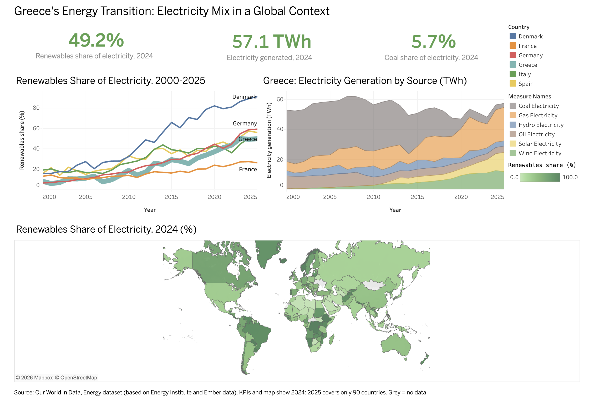

# Greece's Energy Transition | Python, Tableau

Dashboard on how Greece's electricity mix changed between 2000 and 2024, compared with five European countries and the rest of the world, using Our World in Data energy data.

**Live dashboard:** https://public.tableau.com/app/profile/emmanouela.manoloukou/viz/GreeceEnergyTransitionDashboard/GreeceEnergyDashboard

## Business Questions
1. How has Greece's electricity mix changed since 2000?
2. How fast has the share of renewables grown, compared with Denmark, France, Germany, Italy and Spain?
3. How does Greece compare with other countries worldwide?

## Dataset
- Source: [Our World in Data, Energy dataset](https://github.com/owid/energy-data) (built from Energy Institute and Ember data)
- Original file: 23,377 rows and 130 columns (one row per country and year)

## Tools
- **Python (pandas):** data cleaning and quality checks
- **Tableau Public:** KPIs, charts, map and dashboard

## Data Cleaning
- Kept 25 relevant columns out of 130.
- Removed regional aggregates such as "World" and "Europe" (rows without an ISO code).
- Kept the years 2000-2025 and rows with electricity generation data.
- Result: 5,387 rows covering 214 countries.
- Checked for duplicate country-year rows (none) and missing values (under 1% in most columns, 4.3% in wind, mostly countries with no wind generation).

## Key Findings
1. **Coal almost disappeared.** Coal generation fell from 34.3 TWh (64.8% of Greece's electricity) in 2000 to 3.3 TWh (5.7%) in 2024, a drop of about 90%.
2. **Renewables share grew from 7.8% to 49.2%** between 2000 and 2024.
3. **Solar and wind drove the growth.** They went from almost nothing (0.0 and 0.4 TWh) in 2000 to 11.3 and 12.6 TWh in 2024, together about 42% of the 57.1 TWh generated.
4. **Total generation rose only about 8%** (52.9 to 57.1 TWh), so most of the change is a shift in the mix, not extra output.
5. **Greece is mid-table in Europe.** In the line chart, its renewables share in 2024 is below Denmark, Germany and Spain, and above France.

## Notes and Limitations
- The map and KPIs show 2024, because 2025 data covers only 90 countries (2024 covers 196). Grey countries on the map have no data.
- The Greece area chart includes six sources (coal, gas, oil, hydro, solar, wind), so it is slightly below total generation.
- Greece's generation rose from 48.9 TWh in 2023 to 57.1 TWh in 2024. I did not verify the reason, so it is not used as a finding.

## Repository Structure
- `energy_analysis.py` - cleaning and quality checks
- `energy_clean.csv` - cleaned dataset used in Tableau
- `outputs/` - dashboard screenshot

## How to Reproduce
1. Download `owid-energy-data.csv` from the Our World in Data energy repository.
2. Run `python3 energy_analysis.py` in the same folder. It creates `energy_clean.csv`.
3. Connect `energy_clean.csv` in Tableau Public.

*Data: Our World in Data, based on Energy Institute and Ember. Please cite both when reusing.*
